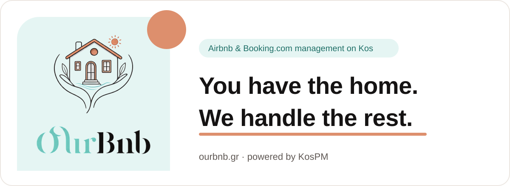
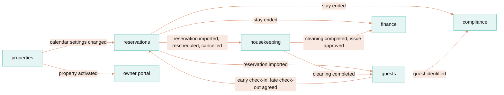
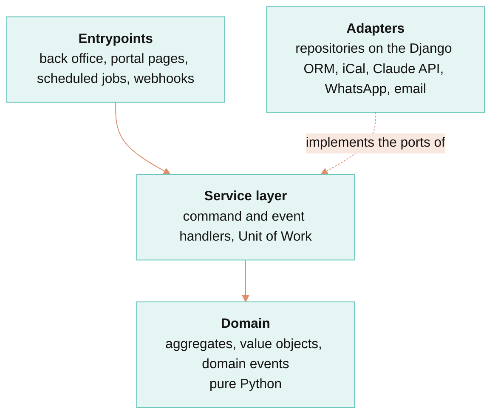

<p align="center">
  <a href="https://ourbnb.gr"></a>
</p>

<h1 align="center">OurBnb</h1>

<p align="center"><b>The platform that runs a short-term rental management business on Kos, Greece.</b></p>

<p align="center">
  
  
  
  
  
  
</p>

OurBnb manages holiday homes for their owners on Airbnb and Booking.com. Behind the public
website, [ourbnb.gr](https://ourbnb.gr), runs **KosPM**, a property-management platform built for
the whole operation: owners, homes, calendars, cleaning teams, guests, money and the declarations
to AADE, the Greek tax authority.

---

## The problem

Managing short-term rentals for many owners is a daily operation, and most of it still runs on
spreadsheets, WhatsApp groups and memory.

- **Calendars.** Every home is listed on several platforms, each with its own calendar. A change
  missed on one of them becomes a double booking.
- **Turnover days.** Guests leave at 11:00 and the next ones arrive at 15:00. A small team has to
  clean many homes in that window, in the right order, without anyone working past their limit.
- **Linen.** Every changeover needs a clean set of sheets and towels on site, washed by a laundry
  and delivered in time.
- **Guests.** The same questions arrive at all hours: the Wi-Fi, the directions, the key box, the
  nearest beach.
- **Money.** Platform payouts, commissions, cleaning charges and taxes passed through to the state
  must turn into a clear monthly statement and payout for every owner.
- **Compliance.** Greek law requires a registry number for every home and a declaration to AADE for
  every stay, by the 20th of the following month. Guest identity data must be protected and deleted
  on time.
- **Owners.** Owners want to see how their home is doing without having to call.

## The business

A Greek private company (IKE) is the legal manager of every home, under a sublease agreement with
its owner. The listings run on the company's own Airbnb and Booking.com accounts, the platforms pay
the company, and the company pays each owner every month, after its commission and charges.

KosPM automates the operations behind this model, so that one small team can run many homes:

1. **Owners join online.** They sign up, describe their home, sign the management contract and
   confirm their bank account. The back office checks each home against an activation checklist.
2. **Calendars stay in sync.** Every 30 minutes the platform reads each home's Airbnb and
   Booking.com calendar, records new and changed reservations, and alerts on overlaps.
3. **Cleanings plan themselves.** Every check-out creates a cleaning with a deadline: the next
   check-in. A daily planner assigns them to the team, by earliest deadline first and within each
   person's daily limit, and warns 30 days ahead when a day will not fit.
4. **The team gets its day on WhatsApp.** At 18:00 the day before, each person receives their plan
   with a link per cleaning: no app and no login. They mark it done, report damage with a photo,
   and the linen stock and the driver's restock route update.
5. **Guests get answers.** Check-in instructions arrive on WhatsApp once the guest is identified.
   An AI assistant answers questions from the home's guide and a local guide, and hands over to a
   person when it is not sure.
6. **Money and declarations follow.** Each stay produces its statement and its AADE declaration
   with the deadline. Owners receive a monthly statement and payout.
7. **Owners see everything.** Bookings, earnings, the next payout and the declarations, in their own
   portal.

## Modules

| Module | What it does |
|---|---|
| Back office | Properties, owners and reservations; each home's activation checklist; a history of every change; Greek and English |
| Owner onboarding portal | Sign-up, the home's profile, contract signing, bank account verification with a €0.01 test transfer |
| Calendar sync | Airbnb and Booking.com calendars every 30 minutes, overlap alerts, questions to the admin about unclear events |
| AI listing reader | Turns the text of an owner's existing listing into a draft profile of the home (Claude API) |
| Cleaning planner | Cleanings from check-outs, daily plans within team limits, overload forecast |
| Linen and restock | Linen stock per home, urgent restocks, the driver's daily route |
| Team on WhatsApp | The final plan the evening before, one link per cleaning, damage reports with photos |
| Guest assistant | Check-in instructions and an AI assistant on WhatsApp, with a local guide |
| Owner payouts | Statement per stay, monthly payout per owner, accounting export |
| AADE compliance | Stay declarations with their deadlines, amendments, scheduled deletion of guest data |
| Owner dashboard | Bookings, earnings, next payout and declarations at a glance |

## Architecture

KosPM is a **modular monolith**: one Django project, one PostgreSQL database and one deploy, split
inside into bounded contexts with strict borders. A small team gets clear boundaries without the
cost of running microservices. The design follows **domain-driven design** and the **hexagonal
architecture** (ports and adapters), with the patterns of *Architecture Patterns with Python*
(Percival and Gregory, [cosmicpython.com](https://www.cosmicpython.com)).

### Bounded contexts

| Context | Type | Responsibility |
|---|---|---|
| `properties` | Core | Owners, homes, contracts, onboarding, check-in guide |
| `reservations` | Core | Calendar import, manual entries, changes and cancellations |
| `housekeeping` | Core | Cleanings, team, daily planning, linen, restock route, damage reports |
| `finance` | Core | Statements per stay, owner charges, monthly payouts, accounting export |
| `guests` | Supporting | Guest identification, conversations, check-in information, AI assistant |
| `local_guide` | Supporting | Recommendations sent to guests |
| `compliance` | Supporting | AADE stay declarations, deadlines, data retention |
| `owner_portal` | Supporting | Read models for owners (the read side of CQRS) |
| `identity` | Generic | Users, roles, owner accounts, signed links for the team |
| `messaging` | Generic | WhatsApp Business API: templates, outbound messages, inbound webhook |

Contexts never import each other's models. They talk through **domain events** on a message bus and
refer to each other only by ID:



### Inside a context

Every context has the same four layers. Dependencies point inwards only: the domain knows nothing
about Django, the database or the outside world.



```
<context>/
  domain/          # pure Python: aggregates, value objects, events, commands, domain services
  service_layer/   # command and event handlers, the Unit of Work interface
  adapters/        # repositories, ORM mapping, external APIs
  entrypoints/     # back office, portal views, management commands, webhooks
```

### Patterns

- **Aggregates** guard the business rules and record what happened as **domain events**.
- **Repositories** return domain objects, never ORM rows; the mapping lives in the adapter.
- **Unit of Work**: one database transaction per command, wrapped around the handler.
- **Message bus**: commands go to one handler; events go to every context that listens, after the
  commit.
- **Transactional outbox**: WhatsApp messages and emails are written to an outbox table in the same
  transaction, and a worker sends them every minute. No message leaves for a change that rolled back.
- **CQRS read models** for the owner dashboard, so that reading never touches the aggregates.
- **Optimistic concurrency**: every aggregate has a version, so two people editing the same home
  cannot overwrite each other's work.
- **Policies as configuration**: team limits, the escalation order, commission rates, the linen par
  level and the cleaning window are configuration objects, not constants inside the algorithms.
- **An injected clock and a Money type**: no hidden `now()` and no floats in business code.

The dependency rules are not a convention: **import-linter** checks them on every push, and
`mypy --strict` runs on the domain and service layers.

### Principles

These rules shape the code as much as the business does:

- **No scraping and no automated logins** to Airbnb or Booking.com. The platform reads only the
  calendar feeds they export, files the admin uploads and what people type.
- **No third-party passwords are stored**, for any platform or public service.
- **Sensitive data is encrypted** at rest (guest ID numbers, key box codes) and deleted on schedule.
- **The AI never decides business rules.** It turns free text into drafts and answers from stored
  data. The domain decides, and a person takes over when the AI is not sure.
- **Money is exact**: decimal amounts in euros, rounded half-up once, at the end.
- **Time is stored in UTC** and reasoned in Europe/Athens.

## Tech stack

| Area | Choice |
|---|---|
| Language | Python 3.12, fully type-hinted |
| Framework | Django 5.2 LTS |
| Back office | Django admin with django-unfold, in Greek and English |
| Owner portal and team pages | Server-rendered Django pages; signed links for the team, no app to install |
| Database | PostgreSQL 16 |
| Background work | Scheduled management commands (supercronic): calendar sync every 30 minutes, outbox worker every minute |
| AI | Claude API (Anthropic SDK) |
| Calendars | iCalendar feeds, read with conditional requests |
| Messaging | WhatsApp Business Cloud API (Meta) |
| Encryption | Fernet (`cryptography`) for sensitive fields |
| Hosting | Docker Compose, Gunicorn, Caddy with automatic HTTPS; staging next to production on a VPS |
| Tooling | uv, ruff, mypy, pytest, import-linter, GitHub Actions |

## Quality

- **About 1,200 automated tests**, written test-first:
  - unit tests of the domain and the handlers, with fake repositories and no database, in milliseconds;
  - integration tests of the repositories and adapters against PostgreSQL;
  - end-to-end tests through the back office, the portal and the scheduled jobs.
- **Every push** runs ruff, `mypy --strict`, import-linter and the tests, and builds the production
  stack.
- **22 architecture decision records** document every choice: the monolith, the outbox, the
  scheduler, the hosting, the AI, the data sources.
- Every text the users see exists in **Greek and English**.

## Source code

KosPM is in active development; its first modules run on a staging server. The source code is
private. For a walkthrough or a demo, get in touch through [my GitHub profile](https://github.com/pikionis).

<p align="center">
  <a href="https://ourbnb.gr"></a><br>
  <sub>ourbnb.gr · Kos, Greece</sub>
</p>
